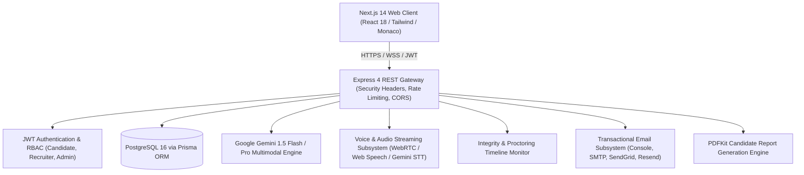

# HireMind AI - Architecture Documentation

## 1. System Overview

**HireMind AI** is an enterprise-grade AI technical recruitment platform designed to automate and augment technical evaluations with deterministic objectivity, transparent candidate ranking, and secure multimodal proctoring.



---

## 2. Monorepo Organization

```
├── client/                     # Next.js 14 App Router Frontend
│   ├── src/
│   │   ├── app/                # App Router Pages & Layouts
│   │   ├── components/         # Reusable UI, Dashboard, Proctoring, Voice Studio
│   │   ├── context/            # Authentication & Global Session Context
│   │   ├── hooks/              # Custom React Hooks (Proctoring, Audio, API)
│   │   ├── lib/                # API Clients (Typed Fetch Abstraction)
│   │   └── types/              # Client-Side Domain Type Definitions
├── server/                     # Node.js + Express Backend
│   ├── prisma/
│   │   ├── schema.prisma       # Prisma Schema (Models, Relations, Indexes)
│   │   └── seed.ts             # Deterministic Database Seed
│   ├── src/
│   │   ├── config/             # Environment (Zod-validated) & Prisma Client
│   │   ├── constants/          # HTTP Statuses & System Constants
│   │   ├── controllers/        # Express Route Handlers
│   │   ├── middlewares/        # Auth, RBAC, Validation, Rate Limiter, Error Handler
│   │   ├── routes/             # Versioned REST API Routes (/api/v1)
│   │   ├── services/           # Business Logic, AI Integrations, Ranking, Reports
│   │   ├── utils/              # Masked Logger, API Response/Error Helpers
│   │   └── validations/        # Zod Schemas for Request Payloads
├── Dockerfile.server           # Multi-stage Server Docker Build
├── Dockerfile.client           # Multi-stage Client Docker Build
├── docker-compose.yml          # Production Orchestration
└── docs/                       # Architectural & API Documentation
```

---

## 3. Core Subsystems

### 3.1 Authentication & Authorization
- **Token Mechanism**: Dual-token architecture using short-lived JWT Access Tokens (15m) and long-lived Refresh Tokens (7d) stored in PostgreSQL with token-family revocation on reuse.
- **RBAC Matrix**:
  - `CANDIDATE`: Profile editing, resume uploads, job applications, interview chamber, coding sandbox.
  - `RECRUITER`: Job requisition management, candidate scoring breakdown, customizable ranking engine, interview review, timeline audit, PDF report downloads.
  - `ADMIN`: Platform settings, infrastructure health, user management.

### 3.2 Multimodal AI & Proctoring Engine
- **Inference Models**: Google Gemini 1.5 Flash for high-speed question generation and speech synthesis, with Gemini 1.5 Pro for deep multi-metric evaluation.
- **Proctoring Timeline**: Captures discrete integrity signals (`TAB_SWITCH`, `CAMERA_OFF`, `MIC_MUTED`, `FACE_LOST`, `MULTI_FACE`, `SUSPICIOUS_AUDIO`) with microsecond timestamps and duration tracking.
- **Fairness Guarantee**: Proctoring events are marked as contextual aids for human recruiter review and strictly separated from AI score calculations.

### 3.3 Candidate Ranking Engine
- **Transparent Scoring Formula**:
  $$\text{Overall Score} = (w_r \cdot S_r) + (w_c \cdot S_c) + (w_t \cdot S_t) + (w_m \cdot S_m) + (w_o \cdot S_o)$$
  Where default weights are:
  - Resume Fit ($w_r$): 20%
  - Coding Assessment ($w_c$): 30%
  - Technical Interview ($w_t$): 25%
  - Communication ($w_m$): 15%
  - Problem Solving / Cultural Alignment ($w_o$): 10%
- Weights can be configured per job by the recruiter.
- Scores are computed deterministically from stored evaluations without re-calling LLMs for arithmetic.

### 3.4 Transactional Notification & Email Subsystem
- **Provider Abstraction**: Pluggable provider architecture (`EmailProvider`) supporting:
  - `ConsoleEmailProvider`: Local development preview.
  - `SmtpEmailProvider`: Standard SMTP relays (Postfix, Amazon SES, Mailgun).
  - `SendGridEmailProvider`: SendGrid v3 REST API.
  - `ResendEmailProvider`: Resend developer API.
- **Event Lifecycle**:
  - Candidate: Application Submitted, Status Changed, Interview Scheduled, Reminder, Completion, Results Ready.
  - Recruiter: New Application, Interview Completed, Proctoring Flag, PDF Report Ready.

### 3.5 PDF Report Generation Engine
- **Generator**: Built on `pdfkit` running natively on Node.js without external browser dependencies (e.g. Puppeteer).
- **Structure**:
  1. Executive Summary & Candidate Demographics
  2. Job Requisition Information
  3. Resume Match & Keyword Analysis
  4. Live Coding Performance & Complexity
  5. Technical & Communication Metric Matrix
  6. Interview Transcript Highlights
  7. Proctoring Integrity Timeline
  8. AI Strengths, Growth Areas & Recommendations
  9. Recruiter Internal Notes & Actionable Decision
- Clearly demarcates **AI-generated evaluation**, **objective test metrics**, and **human recruiter notes**.

---

## 4. Security & Production Hardening

1. **Strict Input Sanitization & Validation**: 100% of API inputs pass through Zod schemas via `validateRequest` middleware.
2. **SQL Injection Protection**: All queries execute via Prisma ORM parameterized SQL statements.
3. **Cross-Site Scripting (XSS)**: Helmet security headers (`xssFilter: true`, `noSniff: true`, `frameguard: deny`) and strict content encoding.
4. **Brute Force Mitigation**: `express-rate-limit` enforces strict thresholds on authentication routes (15 req/15min) and API endpoints (500 req/15min).
5. **Sensitive Data Redaction**: The centralized `Logger` automatically masks passwords, Bearer tokens, JWT strings, and API credentials in application logs.
6. **Isolated Storage**: Candidate resume PDFs are validated for MIME type (`application/pdf`) and size (max 5MB) and saved to secure server-side storage with random UUID filenames.
